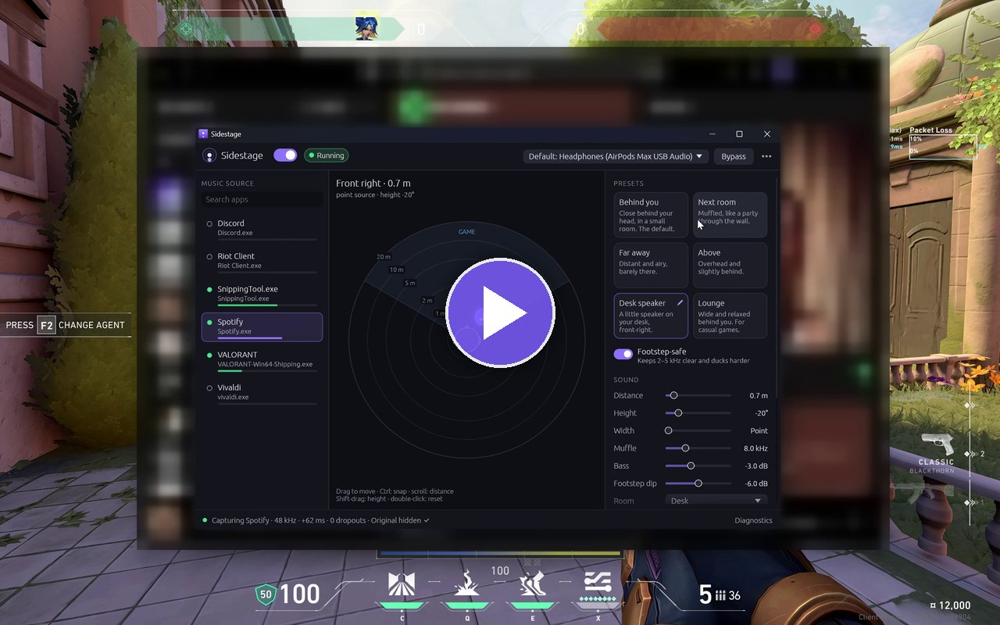
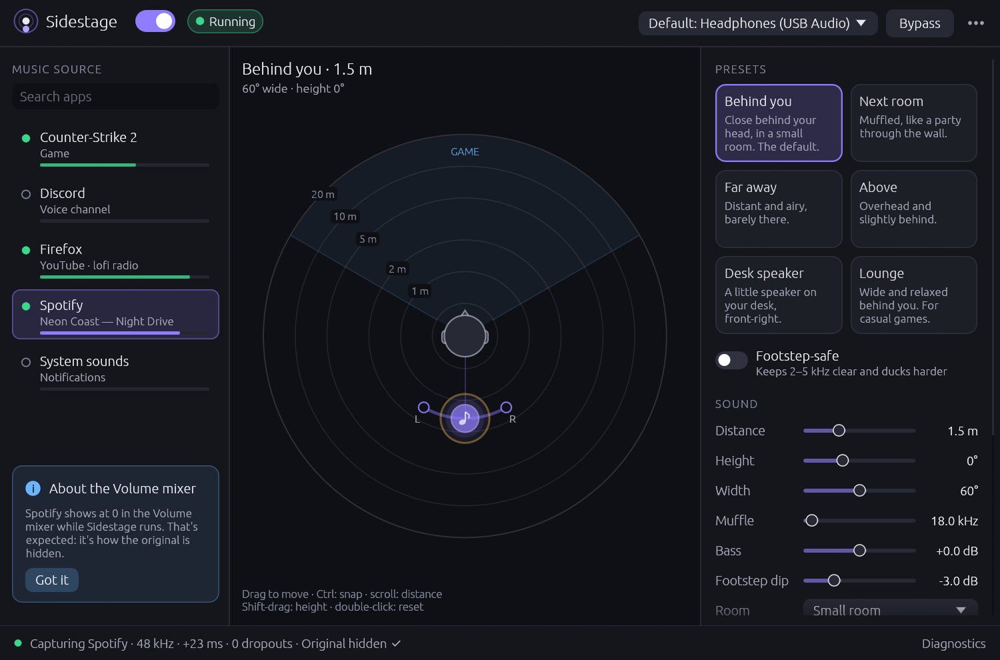
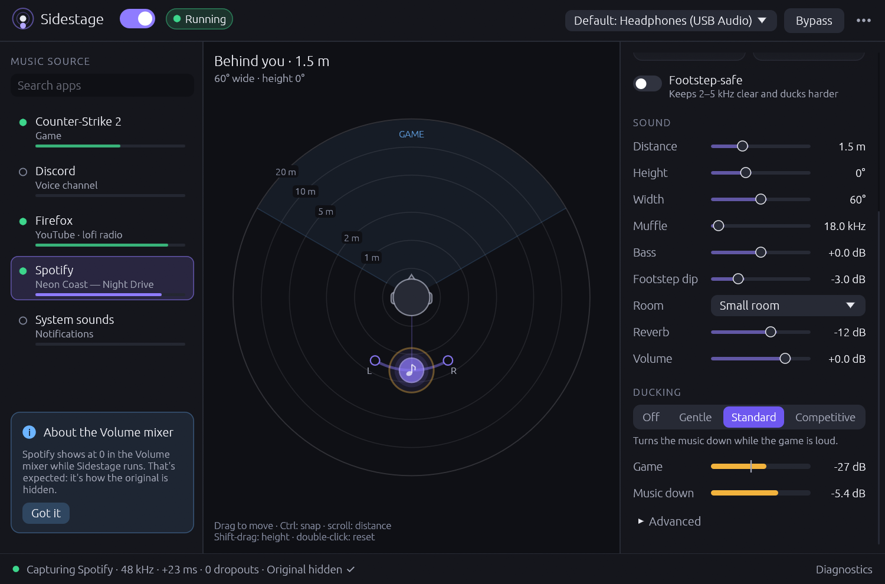
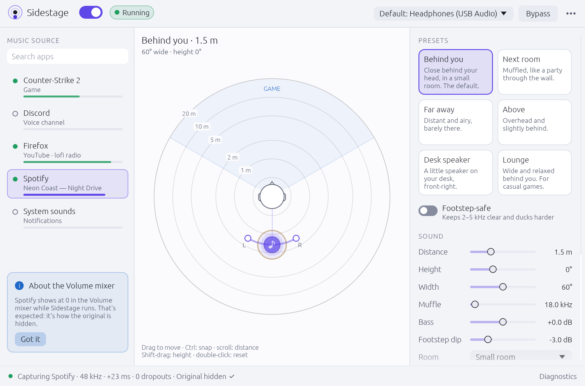
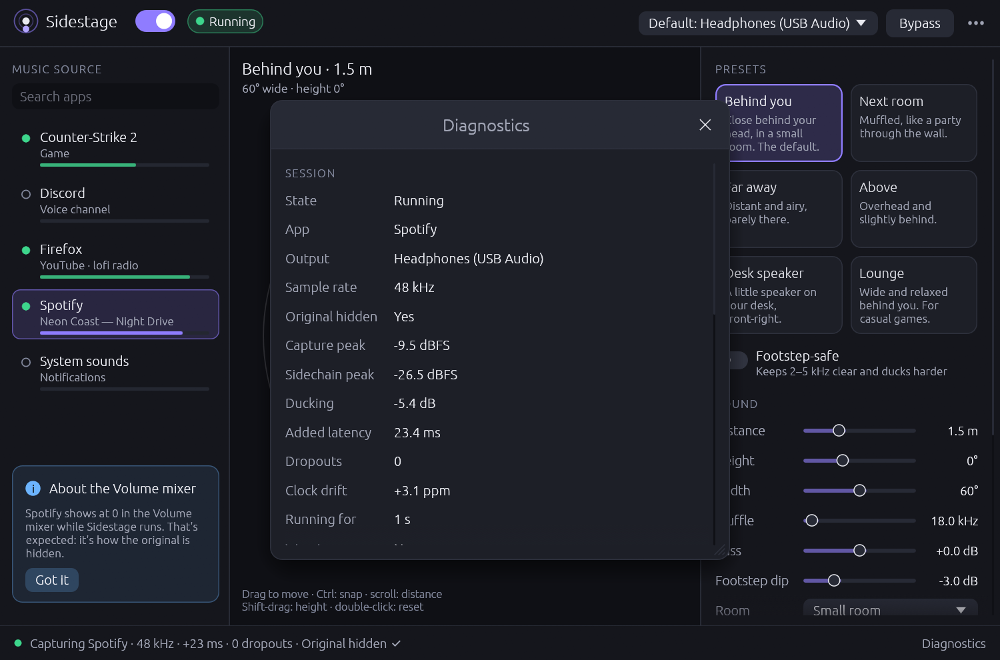

# Sidestage

**Your music moves behind you. Your game audio stays exactly as it is.**

Sidestage takes the sound of one app, usually Spotify, a browser or Apple Music, and plays it in 3D
around your head: behind you, in the next room, far away or overhead. Your game's audio is never
captured or processed, so footsteps and gunshots keep their exact position and timing. Optional
ducking turns the music down while the game is loud.

**Headphones required.** The effect is binaural and does not work on speakers.

<p align="center">
  <a href="docs/media/sidestage-demo.mp4">
    
  </a>
  <br>
  <sub><b>▶ Watch the demo, with sound:</b> Spotify moving around your head while Valorant plays
  normally. Wear headphones.</sub>
</p>

| System | Status (version 0.1) |
|---|---|
| Windows 11 | **Tested.** Spotify spatialized while playing Valorant, with the original hidden and the game untouched. |
| Windows 10, version 2004 or newer | May work, untested. Sidestage warns that capturing one app is not officially supported before build 20348. |
| macOS 14.2 or newer | Builds and passes its tests in CI on macOS. Not yet tried with real music on a Mac. |
| Linux with PipeWire or PulseAudio | Builds and passes its tests in CI on Linux. Not yet tried with real music on a Linux desktop. |

## Screenshots

<table>
  <tr>
    <td></td>
    <td></td>
  </tr>
  <tr>
    <td align="center">Drag the music around your head, or pick a preset</td>
    <td align="center">Sound controls and ducking with live game level</td>
  </tr>
  <tr>
    <td></td>
    <td></td>
  </tr>
  <tr>
    <td align="center">Light theme</td>
    <td align="center">Diagnostics: latency, dropouts, clock drift</td>
  </tr>
</table>

The screenshots use the app's demo mode (`sidestage --demo`), which shows simulated apps.

## Getting started

1. Plug in your headphones and start your music.
2. Open Sidestage and click the app that plays your music in the list on the left.
3. Drag the music around your head on the radar, or pick a preset on the right.

Sidestage remembers the app and starts again whenever that app plays. The power switch at the top
turns Sidestage off, and the app plays normally again.

* **Radar**: drag to move the music (hold Ctrl, or Cmd on a Mac, to snap to 15°). Shift-drag changes
  the height, the mouse wheel changes the distance, and a double-click or Home goes back to the
  preset. Once the radar has focus, the arrow keys nudge the music and Page Up/Down change the
  height.
* **Bypass**: hold the button, or the B key, to hear the music without Sidestage's processing.
* **Footstep-safe**: cuts the music by at least 6 dB around 3.2 kHz, where footsteps live. It also
  rolls off the highs above 8 kHz, sets the bass to -3 dB or lower and switches ducking to
  Competitive. Turning it off brings back your own values.
* **Ducking**: Off, Gentle, Standard or Competitive. It listens to everything except the music and
  Sidestage itself. The listening part ("Measure the game level for ducking" in Diagnostics) is on
  by default.

### Presets

| Preset | Sounds like | Where the music is | Ducking |
|---|---|---|---|
| Behind you (default) | Close behind your head, in a small room | Straight behind, 1.5 m, small room | Standard |
| Next room | Muffled, like a party through the wall | Behind and to the right, 5 m, highs cut above 1.4 kHz | Gentle |
| Far away | Distant and airy, barely there | Behind, 15 m, a little raised, hall | Standard |
| Above | Overhead and slightly behind | 60° up, behind, 2 m, small room | Standard |
| Desk speaker | A little speaker on your desk, front-right | Front-right, below your ears, 0.7 m | Gentle |
| Lounge | Wide and relaxed behind you, for casual games | Behind, a little raised, 2.5 m, wide, living room | Off |

## How it works

Sidestage **captures only the music app**, **hides its normal output** so you don't hear it twice,
and plays the 3D version to your headphones.

| | Capture | Hiding the original | If Sidestage is killed |
|---|---|---|---|
| Windows | WASAPI process loopback | Turns the app down to -120 dB and boosts the captured copy back up by the same amount. The Volume mixer shows the app at 0 while Sidestage runs. That is expected. | A helper process puts the app's volume back right away. |
| macOS | Core Audio process tap | macOS mutes the app while Sidestage taps it. The first start asks for audio-capture permission. | macOS un-mutes the app by itself. No helper is needed. |
| Linux | A private, silent output with a random name (PulseAudio null sink) | The app's streams are moved onto that output. | A watchdog process moves the app back and removes the output. |

Every start also checks for anything an earlier run left behind and puts it back.
`sidestage restore` does the same from the command line.

## Command line

```text
sidestage                         open the window
sidestage --demo                  open the window with simulated apps (captures and plays nothing)
sidestage list                    list apps that have audio right now, with their keys
sidestage outputs                 list output devices and their IDs
sidestage run <app> [--preset <name>] [--seconds <n>]
                                  spatialize <app> without the window, until Ctrl+C
sidestage restore                 undo audio changes left behind by a killed Sidestage
sidestage --help | --version
```

* `<app>` is any part of an app's name or key from `sidestage list`, for example `spotify`. An exact
  name wins over a prefix or a part of the name. If several apps match equally well and exactly one
  of them is playing, that one is used; otherwise `run` asks you to be more specific.
* Preset names: `behind`, `next-room`, `far`, `above`, `desk`, `lounge`. Without `--preset`, `run`
  uses the sound settings saved by the window (Behind you if there are none). It always uses the
  window's saved output device, hiding method and ducking setting.
* `run` waits until a matching app shows up in `sidestage list`. It stops on Ctrl+C or when
  `--seconds` runs out.
* Only one Sidestage changes your audio at a time. While one is running, a second window, `run` or
  `restore` says so and leaves your audio alone.
* Exit codes: 0 for success, 1 for an error, 2 for a usage error. Set `RUST_LOG=debug` for detailed
  logs, or `SIDESTAGE_DEMO=1` to try the commands with simulated apps.
* Windows release builds are window programs, so cmd and PowerShell show the prompt again straight
  away, and the output of `run` appears below it.

## Troubleshooting

* **The music app is silent, or stuck on Sidestage's output**, for example after a crash, a power
  cut, or a shutdown while Sidestage was running. Open the music app, then start Sidestage once or
  run `sidestage restore`. In the window, Diagnostics > **Stop and restore original audio** does the
  same. On Windows, an app that is closed gets its volume back the next time it plays while
  Sidestage or its helper is running.
* **Windows: the Volume mixer shows the music app at 0.** That is how the original is hidden.
* **Windows: the original plays for a moment when the app's volume changes.** Sidestage takes the
  new level as the music volume and hides the app again within about 0.2 s. Use Sidestage's Volume
  slider instead of the Volume mixer.
* **You hear the music twice.** The hiding method is set to keep the original. Click **Hide the
  original** on the warning card, or pick the recommended method under Hide the original in
  Diagnostics.
* **macOS: no sound, or a permission message.** Allow Sidestage in System Settings > Privacy &
  Security > Screen & System Audio Recording ("System Audio Recording Only"), then start again (quit
  and reopen Sidestage if it still fails). When Sidestage runs from a terminal, macOS asks on behalf
  of the terminal app. See [packaging/macos/README.md](packaging/macos/README.md).
* **Linux: an output called "Sidestage Music Capture" shows up in your sound settings.** That is the
  private output the music is moved to. Don't pick it as your output. It goes away when Sidestage
  stops.
* **Ducking does nothing.** Make sure "Measure the game level for ducking" is on in Diagnostics. On
  Linux, ducking only hears games that play to the same output as Sidestage.
* **The 3D effect sounds wrong.** On Windows, turn off spatial sound (Windows Sonic, Dolby Atmos or
  DTS) for your headphones. Bluetooth headsets in hands-free (mic) mode switch to low-quality mono
  and lose the effect. On Windows, Sidestage warns about both.

### Files and logs

| | Settings | Logs, instance lock and crash journals |
|---|---|---|
| Windows | `%APPDATA%\Sidestage\config\config.json` | `%LOCALAPPDATA%\Sidestage\data\` |
| macOS | `~/Library/Application Support/Sidestage/config.json` | `~/Library/Application Support/Sidestage/` |
| Linux | `~/.config/sidestage/config.json` | `~/.local/state/sidestage/` |

On Linux, `$XDG_CONFIG_HOME` and `$XDG_STATE_HOME` are used when they are set. The window writes
`sidestage.log` and keeps the previous run's log as `sidestage.prev.log`. Command-line commands log
to the terminal only. On Windows, the crash helper writes `windows-guardian.log` in the same folder.
The Diagnostics window shows the settings and log paths.

## Privacy

* Sidestage has no network code. It sends nothing anywhere: no telemetry, no accounts and no update
  checks. On Linux it also refuses to use a remote sound server.
* Audio is processed in memory only. Nothing is recorded or saved.
* On disk it keeps only its settings, its logs, and small crash-recovery journals that record which
  app volumes or routes to put back. Logs contain app and device names.

## Build from source

You need Rust 1.95 or newer.

```bash
cargo run --release           # build and start the app
cargo test --workspace        # run the tests
```

* **Windows**: the default MSVC toolchain needs the Visual Studio C++ build tools. This is what CI
  builds; `.cargo/config.toml` links the C runtime statically, so the exe runs without the Visual
  C++ Redistributable. For the GNU route, use the `x86_64-pc-windows-gnullvm` toolchain with
  [llvm-mingw](https://github.com/mstorsjo/llvm-mingw) as the linker, for example in
  `~/.cargo/config.toml`:

  ```toml
  [target.x86_64-pc-windows-gnullvm]
  linker = "C:/path/to/llvm-mingw/bin/x86_64-w64-mingw32-clang.exe"
  # Optional: link the C runtime statically so the exe needs no llvm-mingw DLLs.
  rustflags = ["-C", "target-feature=+crt-static"]
  ```

  Then run `rustup toolchain install stable-x86_64-pc-windows-gnullvm` and, in the checkout,
  `rustup override set stable-x86_64-pc-windows-gnullvm`. The plain `x86_64-pc-windows-gnu`
  toolchain cannot link the current `windows` crates without a working GNU `dlltool`.
* **macOS**: install the Xcode command line tools. `cargo run` works directly: the build script
  embeds the Info.plist (macOS only asks for capture permission when it is there) and sets the
  binary's deployment target to 14.2. Export `MACOSX_DEPLOYMENT_TARGET=14.2` to apply that floor to
  every crate, as CI and the bundle script do. `packaging/macos/make-app.sh` (or
  `make-app.sh --universal`) builds `target/macos-app/Sidestage.app` and a zip. See
  [packaging/macos/README.md](packaging/macos/README.md) for signing and permissions.
* **Linux**: you need Rust and a C toolchain for linking. No PulseAudio or PipeWire development
  packages are needed: Sidestage speaks the PulseAudio protocol itself, which PipeWire also provides
  through pipewire-pulse. The window's system libraries (Wayland or X11, xkbcommon, OpenGL) are
  loaded at run time, so CI builds without installing any `-dev` packages. If your build complains
  anyway, install `libxkbcommon-dev libxcb-render0-dev libxcb-shape0-dev libxcb-xfixes0-dev
  libgl1-mesa-dev`. To run it you need PulseAudio, or PipeWire with pipewire-pulse.

## Known limitations

* Headphones only. Generic head models sometimes place "behind" sounds in front of you (front/back
  confusion). Moving the music a little to one side, or adding distance and room, helps.
* Windows: the hiding has short gaps. The original is audible for about 0.2 s after the app's volume
  changes, and for about 50-200 ms when the app opens a new audio stream. If the PC shuts down, logs
  off or loses power while Sidestage runs, the music app can stay silent until Sidestage next starts
  (see Troubleshooting).
* Windows: if two copies of the same program play audio, only one of them is captured.
* macOS: changing the output or its sample rate rebuilds the capture, so the original is audible for
  a moment. User-made aggregate or multi-output devices can't be used as the output.
* Linux: there is no option to keep the original audible. A brand-new stream from the music app
  plays unprocessed for about 60 ms, plus the time the move takes.

[docs/DESIGN.md](docs/DESIGN.md) has the full list and how each OS backend works.

## Project layout

| Path | What |
|---|---|
| `crates/sidestage` | The egui app and the command line |
| `crates/sidestage-dsp` | Binaural renderer: spherical-head model, room, ducking, limiter. Pure Rust. |
| `crates/sidestage-platform` | Per-OS capture, hiding and output behind one trait, plus the Windows live-test tools in `examples/` |
| `packaging/macos` | Info.plist, entitlements and the `Sidestage.app` bundle script |
| `docs/DESIGN.md` | Architecture, the reasoning behind each OS strategy, and testing |

## Credits

The head model follows C. P. Brown and R. O. Duda, "A structural model for binaural sound
synthesis", IEEE Trans. Speech and Audio Processing 6(5), 1998. The rear and elevation cues use
Blauert's directional bands.

## License

Licensed under either of

* Apache License, Version 2.0 ([LICENSE-APACHE](LICENSE-APACHE) or
  <https://www.apache.org/licenses/LICENSE-2.0>)
* MIT license ([LICENSE-MIT](LICENSE-MIT) or <https://opensource.org/licenses/MIT>)

at your option.

Unless you explicitly state otherwise, any contribution intentionally submitted for inclusion in
Sidestage by you, as defined in the Apache-2.0 license, shall be dual licensed as above, without
any additional terms or conditions.

Release binaries also contain third-party Rust crates under their own permissive licenses (MIT,
Apache-2.0, BSD, Zlib, ISC, BSL-1.0, MPL-2.0 and similar) and egui's built-in fonts, which are under
the SIL Open Font License 1.1 and the Ubuntu Font Licence 1.0.
