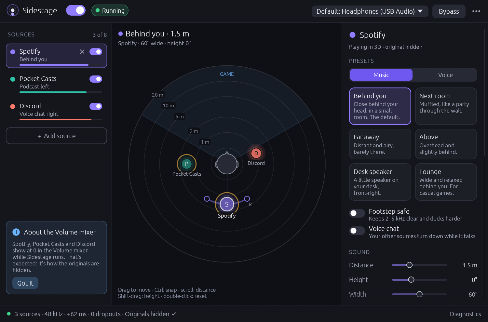
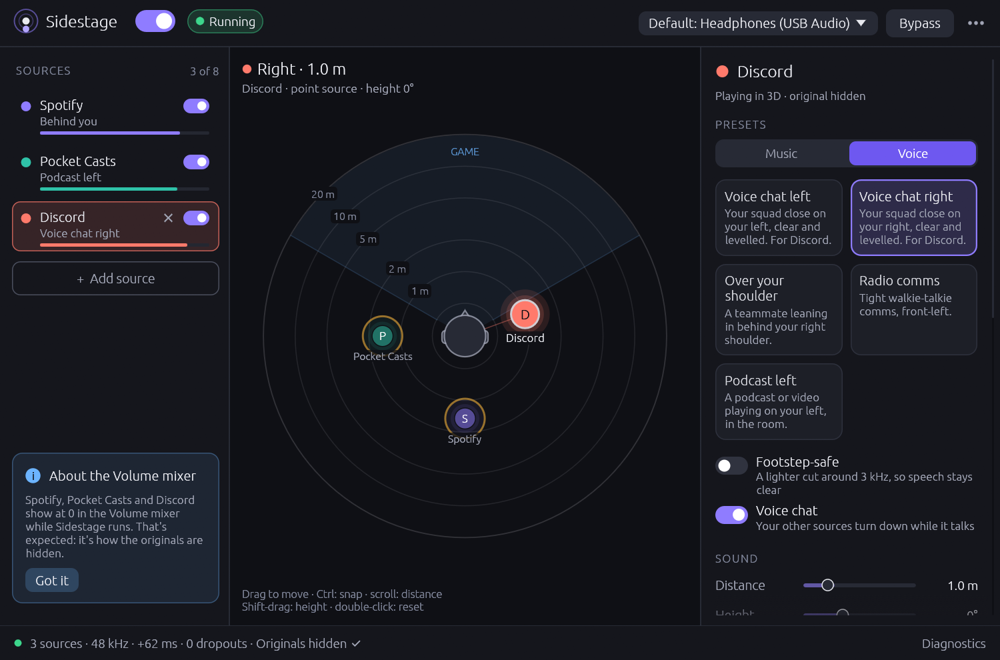
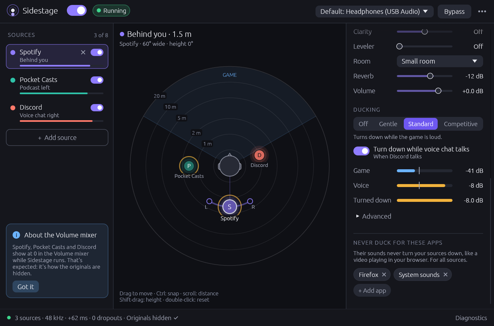

# Sidestage

**Music behind you, a podcast on your left, Discord on your right. Your game audio stays exactly
as it is.**

Sidestage takes the sound of the apps you pick (your music player, a podcast or video, voice
chat) and plays each one in 3D at its own spot around your head: behind you, beside you, over
your shoulder, in the next room or far away. Your game's audio is never captured or processed, so
footsteps and gunshots keep their exact position and timing. Your sources can turn down while the
game is loud or while your friends talk, and voice chat is never turned down for the game.

**Headphones required.** The effect is binaural and does not work on speakers.

<p align="center">
  
  <br>
  <sub>Spotify behind you, a podcast on your left and Discord on your right, each with its own
  preset.</sub>
</p>

| System | Status |
|---|---|
| Windows 11 | **Tested on real hardware.** Several sources at once: tested live with test tones (capture, hiding, adding and removing sources while others play, crash recovery, ducking). One source (version 0.1): Spotify spatialized while playing Valorant, with the original hidden and the game untouched. Several real apps at once have not been tried yet. |
| Windows 10, version 2004 or newer | May work, untested. Sidestage warns that capturing one app is not officially supported before build 20348. |
| macOS 14.2 or newer | Builds and passes its tests in CI on macOS. Not yet tried with real audio on a Mac. |
| Linux with PipeWire or PulseAudio | Builds and passes its tests in CI on Linux. Not yet tried with real audio on a Linux desktop. |

## Screenshots

<table>
  <tr>
    <td width="50%"></td>
    <td width="50%"></td>
  </tr>
  <tr>
    <td align="center">Voice presets: Discord close on your right</td>
    <td align="center">Ducking for the game and for voice chat, and apps that never duck</td>
  </tr>
  <tr>
    <td></td>
    <td></td>
  </tr>
  <tr>
    <td align="center">Light theme</td>
    <td align="center">Diagnostics for the session and each source</td>
  </tr>
</table>

The screenshots use the app's demo mode (`sidestage --demo`), which shows simulated apps.

### Demo video (version 0.1, one source)

<p align="center">
  <a href="docs/media/sidestage-demo.mp4">
    
  </a>
  <br>
  <sub><b>▶ Watch the demo, with sound:</b> Sidestage 0.1 moving Spotify around your head while
  Valorant plays normally. It was recorded before Sidestage could play several apps at once. Wear
  headphones.</sub>
</p>

## Getting started

1. Plug in your headphones and start the apps you want around you, for example your music and
   Discord.
2. Open Sidestage. The list of apps with audio opens on the left (later, click **+ Add source**).
   Click an app to add it. It gets a preset that suits it: voice chat apps such as Discord or
   TeamSpeak go close beside you, anything else goes behind you or to the next music preset no
   other source uses.
3. Add more apps the same way, up to 8. Click a source in the list, or its dot on the radar, to
   select it. Then drag it around your head or pick a preset on the right.

Sidestage remembers your sources and starts whenever one of their apps plays; the others join as
soon as they play. Each source has an on/off switch (off: that app plays normally and keeps its
settings) and a × that removes it, with Undo. The power switch at the top turns Sidestage off, and
every app plays normally again.

* **Radar**: one dot per source. Drag to move the selected source (hold Ctrl, or Cmd on a Mac, to
  snap to 15°). Shift-drag changes the height, the mouse wheel changes the distance, and a
  double-click or Home goes back to its preset. Once the radar has focus, the arrow keys nudge the
  source and Page Up/Down change the height.
* **Sound**: each source has its own distance, height, width, tone, room and volume. **Clarity**
  lifts the band around 2.5 kHz that makes speech clear, and **Leveler** evens out loud and quiet
  talkers. The voice presets turn both on.
* **Bypass**: hold the button, or the B key, to hear every source without Sidestage's processing.

### Presets

Music presets:

| Preset | `run` name | Sounds like |
|---|---|---|
| Behind you (default) | `behind` | Close behind your head, in a small room |
| Next room | `next-room` | Muffled, like a party through the wall |
| Far away | `far` | Distant and airy, barely there |
| Above | `above` | Overhead and slightly behind |
| Desk speaker | `desk` | A little speaker on your desk, front-right |
| Lounge | `lounge` | Wide and relaxed behind you, for casual games (no ducking for the game) |

Voice presets are close, clear and levelled, in a little room so voices sound outside your head:

| Preset | `run` name | Sounds like |
|---|---|---|
| Voice chat left | `voice-left` | Your squad close on your left |
| Voice chat right | `voice-right` | Your squad close on your right |
| Over your shoulder | `shoulder` | A teammate leaning in behind your right shoulder |
| Radio comms | `radio` | Tight walkie-talkie comms, front-left |
| Podcast left | `podcast-left` | A podcast or video playing on your left, in the room |

The first four mark the source as voice chat. Podcast left is spoken word, not voice chat: it
ducks gently, like music.

### Ducking and voice chat

* **Ducking** (per source): Off, Gentle, Standard or Competitive. The source turns down while the
  game is loud. For Sidestage, "the game" is everything except your sources, the apps in "Never
  duck for these apps" and Sidestage itself. The listening part ("Measure the game level for
  ducking" in Diagnostics) is on by default.
* **Voice chat** (per source): the voice chat presets turn it on, or use the switch. Voice chat is
  never turned down for the game. Sources with **Turn down while voice chat talks** (on for the
  music presets and Podcast left) get quieter whenever it talks, with the same strength as their
  game ducking, even when that is Off.
* **Never duck for these apps**: apps whose sound should never turn your sources down, for example
  a browser playing a video or a second music player. The list applies to all sources. Your
  sources never count as the game anyway.
* **Footstep-safe** (per source): cuts the source by at least 6 dB around 3.2 kHz, where footsteps
  live. It also rolls off the highs above 8 kHz, sets the bass to -3 dB or lower and switches
  ducking to Competitive. On a voice chat source it is lighter, so speech stays clear: a cut of at
  least 3 dB around 3.2 kHz and a roll-off above 10 kHz, with ducking, bass, Clarity and Leveler
  left alone. Turning it off brings back your own values.

## How it works

Sidestage **captures only the apps you added**, **hides their normal output** so you don't hear
them twice, renders each one at its own position and plays the mix to your headphones. A final
limiter on the mix keeps several loud sources from clipping.

| | Capture | Hiding the originals | If Sidestage is killed |
|---|---|---|---|
| Windows | WASAPI process loopback, one capture per source | Turns each source's app down to -120 dB and boosts the captured copy back up by the same amount. The Volume mixer shows every source's app at 0 while Sidestage runs. That is expected. | A helper process puts every app's volume back right away. |
| macOS | Core Audio process taps, one per source | macOS mutes each app while Sidestage taps it. The first start asks for audio-capture permission. | macOS un-mutes the apps by itself. No helper is needed. |
| Linux | A private, silent output per source with a random name (PulseAudio null sink) | The app's streams are moved onto its output. | A watchdog process moves the apps back and removes the outputs. |

Every start also checks for anything an earlier run left behind and puts it back.
`sidestage restore` does the same from the command line.

## Command line

```text
sidestage                         open the window
sidestage --demo                  open the window with simulated apps (captures and plays nothing)
sidestage list                    list apps that have audio right now, with their keys
sidestage outputs                 list output devices and their IDs
sidestage presets                 list the presets and their command-line names
sidestage run <app>[=<preset>] [<app>[=<preset>] ...] [--preset <name>] [--seconds <n>]
                                  spatialize up to 8 apps without the window, until Ctrl+C
sidestage restore                 undo audio changes left behind by a killed Sidestage
sidestage --help | --version
```

For example, music behind you, a podcast on your left and Discord on your right:

```text
sidestage run spotify "pocket casts=podcast-left" discord
```

* `<app>` is any part of an app's name or key from `sidestage list`, for example `spotify`. Quote
  names with spaces. An exact name wins over a prefix or a part of the name. If several apps match
  equally well and exactly one of them is playing, that one is used; otherwise `run` asks you to be
  more specific. Each app can only be given once.
* `=<preset>` picks that app's preset (the `run` names in the tables above), and `--preset` picks
  one for the apps without their own. Otherwise an app uses the sound settings the window saved
  for it, or the preset the window would give it (Discord gets Voice chat right). `run` always
  uses the window's saved output device, hiding method, ducking measurement and "Never duck"
  list.
* `run` starts as soon as one of the apps has audio and adds the others when they start playing.
  It stops on Ctrl+C or when `--seconds` runs out.
* Only one Sidestage changes your audio at a time. While one is running, a second window, `run` or
  `restore` says so and leaves your audio alone.
* Exit codes: 0 for success, 1 for an error, 2 for a usage error. Set `RUST_LOG=debug` for detailed
  logs, or `SIDESTAGE_DEMO=1` to try the commands with simulated apps.
* Windows release builds are window programs, so cmd and PowerShell show the prompt again straight
  away, and the output of `run` appears below it.

## Troubleshooting

* **An app is silent, or stuck on Sidestage's output**, for example after a crash, a power cut, or
  a shutdown while Sidestage was running. Open the app, then start Sidestage once or run
  `sidestage restore`. In the window, Diagnostics > **Stop and restore original audio** does the
  same. On Windows, an app that is closed gets its volume back the next time it plays while
  Sidestage or its helper is running.
* **Windows: the Volume mixer shows your sources' apps at 0.** That is how the originals are
  hidden. Every app you add as a source shows at 0 while Sidestage runs.
* **Windows: an app's original plays for a moment when its volume changes.** Sidestage takes the
  new level as that source's volume and hides the app again within about 0.2 s. Use the source's
  Volume slider in Sidestage instead of the Volume mixer.
* **You hear your apps twice.** The hiding method is set to keep the originals. Click **Hide the
  originals** on the warning card, or pick Automatic under Hide the originals in Diagnostics.
* **An app can't be added twice.** An app can only be one source: the app list marks the ones
  already added, and `run` refuses an app that is given twice. Two copies of the same program
  count as one app, and only one of them is captured.
* **"8 sources is the most".** Sidestage plays up to 8 sources at once, switched-off ones included.
  Remove one to add another.
* **macOS: no sound, or a permission message.** Allow Sidestage in System Settings > Privacy &
  Security > Screen & System Audio Recording ("System Audio Recording Only"), then start again (quit
  and reopen Sidestage if it still fails). When Sidestage runs from a terminal, macOS asks on behalf
  of the terminal app. See [packaging/macos/README.md](packaging/macos/README.md).
* **Linux: outputs called "Sidestage Capture - ..." show up in your sound settings.** There is one
  per source, even while its app is not running: the private outputs the apps are moved to. Don't
  pick one as your output. Each goes away when its source is removed or Sidestage stops.
* **Ducking does nothing.** Make sure "Measure the game level for ducking" is on in Diagnostics
  and the game is not in "Never duck for these apps". On Linux, ducking only hears games that play
  to the same output as Sidestage.
* **The music doesn't turn down when your friends talk.** Turn on **Voice chat** for the chat app's
  source (a voice chat preset does that) and **Turn down while voice chat talks** for the music.
* **The 3D effect sounds wrong.** On Windows, turn off spatial sound (Windows Sonic, Dolby Atmos or
  DTS) for your headphones. Bluetooth headsets in hands-free (mic) mode switch to low-quality mono
  and lose the effect. On Windows, Sidestage warns about both.

### Files and logs

| | Settings | Logs, instance lock and crash journals |
|---|---|---|
| Windows | `%APPDATA%\Sidestage\config\config.json` | `%LOCALAPPDATA%\Sidestage\data\` |
| macOS | `~/Library/Application Support/Sidestage/config.json` | `~/Library/Application Support/Sidestage/` |
| Linux | `~/.config/sidestage/config.json` | `~/.local/state/sidestage/` |

On Linux, `$XDG_CONFIG_HOME` and `$XDG_STATE_HOME` are used when they are set. A version 0.1
settings file is upgraded on the first start: its app becomes your first source, and the original
is kept as `config.json.v1`. A settings file Sidestage cannot fully read is kept as
`config.json.broken`, and one from a newer Sidestage as `config.json.newer`. The window writes
`sidestage.log` and keeps the previous run's log as `sidestage.prev.log`. Command-line commands log
to the terminal only. On Windows, the crash helper writes `windows-guardian.log` in the same folder.
The Diagnostics window shows the settings and log paths. `SIDESTAGE_CONFIG_DIR` and
`SIDESTAGE_STATE_DIR` move the settings folder and the state folder, for example for a test run
beside your own Sidestage.

## Privacy

* Sidestage has no network code. It sends nothing anywhere: no telemetry, no accounts and no update
  checks. On Linux it also refuses to use a remote sound server.
* Audio is processed in memory only. Nothing is recorded or saved.
* On disk it keeps only its settings, its logs, and small crash-recovery journals that record which
  app volumes or routes to put back. Logs contain app and device names.

## Build from source

You need Rust 1.95 or newer.

```bash
cargo run --release           # build and start the app
cargo test --workspace        # run the tests
```

* **Windows**: the default MSVC toolchain needs the Visual Studio C++ build tools. This is what CI
  builds; `.cargo/config.toml` links the C runtime statically, so the exe runs without the Visual
  C++ Redistributable. For the GNU route, use the `x86_64-pc-windows-gnullvm` toolchain with
  [llvm-mingw](https://github.com/mstorsjo/llvm-mingw) as the linker, for example in
  `~/.cargo/config.toml`:

  ```toml
  [target.x86_64-pc-windows-gnullvm]
  linker = "C:/path/to/llvm-mingw/bin/x86_64-w64-mingw32-clang.exe"
  # Optional: link the C runtime statically so the exe needs no llvm-mingw DLLs.
  rustflags = ["-C", "target-feature=+crt-static"]
  ```

  Then run `rustup toolchain install stable-x86_64-pc-windows-gnullvm` and, in the checkout,
  `rustup override set stable-x86_64-pc-windows-gnullvm`. The plain `x86_64-pc-windows-gnu`
  toolchain cannot link the current `windows` crates without a working GNU `dlltool`.
* **macOS**: install the Xcode command line tools. `cargo run` works directly: the build script
  embeds the Info.plist (macOS only asks for capture permission when it is there) and sets the
  binary's deployment target to 14.2. Export `MACOSX_DEPLOYMENT_TARGET=14.2` to apply that floor to
  every crate, as CI and the bundle script do. `packaging/macos/make-app.sh` (or
  `make-app.sh --universal`) builds `target/macos-app/Sidestage.app` and a zip. See
  [packaging/macos/README.md](packaging/macos/README.md) for signing and permissions.
* **Linux**: you need Rust and a C toolchain for linking. No PulseAudio or PipeWire development
  packages are needed: Sidestage speaks the PulseAudio protocol itself, which PipeWire also provides
  through pipewire-pulse. The window's system libraries (Wayland or X11, xkbcommon, OpenGL) are
  loaded at run time, so CI builds without installing any `-dev` packages. If your build complains
  anyway, install `libxkbcommon-dev libxcb-render0-dev libxcb-shape0-dev libxcb-xfixes0-dev
  libgl1-mesa-dev`. To run it you need PulseAudio, or PipeWire with pipewire-pulse.

## Known limitations

* Headphones only. Generic head models sometimes place "behind" sounds in front of you (front/back
  confusion). Moving a source a little to one side, or adding distance and room, helps.
* The voice presets were tuned by measurement with speech-like test signals, not yet by listening
  to real voice chat.
* Windows: the hiding has short gaps. An app's original is audible for about 0.2 s after its volume
  changes, and for about 50-200 ms when it opens a new audio stream. If the PC shuts down, logs off
  or loses power while Sidestage runs, the apps can stay silent until Sidestage next starts (see
  Troubleshooting).
* Windows: if two copies of the same program play audio, only one of them is captured. A launcher
  and a program it started should not both be sources.
* macOS: when the set of captured apps changes (a source is added or removed, or a source's app
  starts playing) or the output or its sample rate changes, the other sources dip for a moment
  (estimated at 10-25 ms) while Sidestage switches to a new capture device. User-made aggregate or
  multi-output devices can't be used as the output.
* Linux: there is no option to keep the originals audible. A brand-new stream from a source's app
  plays unprocessed for about 60 ms, plus the time the move takes. Removing a source while it plays
  cuts it off without a fade.

[docs/DESIGN.md](docs/DESIGN.md) has the full list and how each OS backend works.

## Project layout

| Path | What |
|---|---|
| `crates/sidestage` | The egui app and the command line |
| `crates/sidestage-dsp` | Binaural renderer: spherical-head model, room, voice leveller, ducking, limiter, and the master bus for the mix. Pure Rust. |
| `crates/sidestage-platform` | Per-OS capture, hiding and output for several apps behind one trait, plus the Windows live-test tools in `examples/` |
| `packaging/macos` | Info.plist, entitlements and the `Sidestage.app` bundle script |
| `docs/DESIGN.md` | Architecture, the reasoning behind each OS strategy, and testing |

## Credits

The head model follows C. P. Brown and R. O. Duda, "A structural model for binaural sound
synthesis", IEEE Trans. Speech and Audio Processing 6(5), 1998. The rear and elevation cues use
Blauert's directional bands.

## License

Licensed under either of

* Apache License, Version 2.0 ([LICENSE-APACHE](LICENSE-APACHE) or
  <https://www.apache.org/licenses/LICENSE-2.0>)
* MIT license ([LICENSE-MIT](LICENSE-MIT) or <https://opensource.org/licenses/MIT>)

at your option.

Unless you explicitly state otherwise, any contribution intentionally submitted for inclusion in
Sidestage by you, as defined in the Apache-2.0 license, shall be dual licensed as above, without
any additional terms or conditions.

Release binaries also contain third-party Rust crates under their own permissive licenses (MIT,
Apache-2.0, BSD, Zlib, ISC, BSL-1.0, MPL-2.0 and similar) and egui's built-in fonts, which are under
the SIL Open Font License 1.1 and the Ubuntu Font Licence 1.0.
